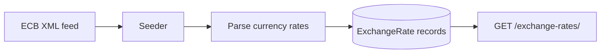

# Currency exchange API

A compact FastAPI service that imports European Central Bank reference rates into SQLAlchemy models and exposes the rates recorded for the current day.

The project demonstrates XML ingestion, persistence, response schemas, dependency-injected database sessions, tests and container setup. It is a learning API rather than a production foreign-exchange feed.

## Data flow



For each imported currency, the seeder reads the most recently stored rate and saves:

- the current ECB reference rate;
- the import timestamp;
- `change`, calculated as `current rate - previous stored rate`.

`change` is an absolute rate difference, not a percentage. The API currently returns records created after local midnight. If no import has run today—commonly on weekends or before the daily refresh—the response can contain an empty rates list rather than the latest available business-day data.

## Run locally

```bash
git clone https://github.com/alirazawatoo/currency-exchange.git
cd currency-exchange
python -m venv .venv
source .venv/bin/activate
pip install -r requirements.txt
python seeders.py
fastapi dev main.py
```

On Windows PowerShell, activate with `.venv\Scripts\Activate.ps1`.

The seeder performs an external ECB request.

## API

`GET /exchange-rates/`

Example response shape:

```json
{
  "rates": [
    {
      "currency": "USD",
      "rate": 1.1234,
      "change": 0.0014
    }
  ]
}
```

The exact schema is defined under `schemas/`, while the route implementation lives in `resources/exchange_rates.py`.

## Docker

```bash
docker compose up --build
```

The repository includes a Dockerfile and Compose configuration for a repeatable local setup. Review the configuration before using it outside development.

## Tests

```bash
pytest
```

Test source covers the exchange-rate model and API resource behavior.

## Current reliability boundaries

- The ECB HTTP request has no explicit timeout.
- Upstream XML and network failures use a generic exception path.
- Each currency record is committed separately rather than in one transaction.
- “Today” uses application-local time and does not fall back to the latest available rate date.
- The saved change is an absolute subtraction, not percentage movement.

A production iteration should add a request timeout, structured upstream errors, transactional imports, duplicate-import policy, explicit timezone handling and a latest-business-day endpoint.

## Repository map

```text
main.py                 FastAPI application
database.py             SQLAlchemy engine and session dependency
models/                 Persisted exchange-rate model
schemas/                API response models
resources/              HTTP route
utils/exchange_rate.py  ECB fetch, parse and persistence logic
seeders.py              Import entrypoint
tests/                   Model and resource tests
```
